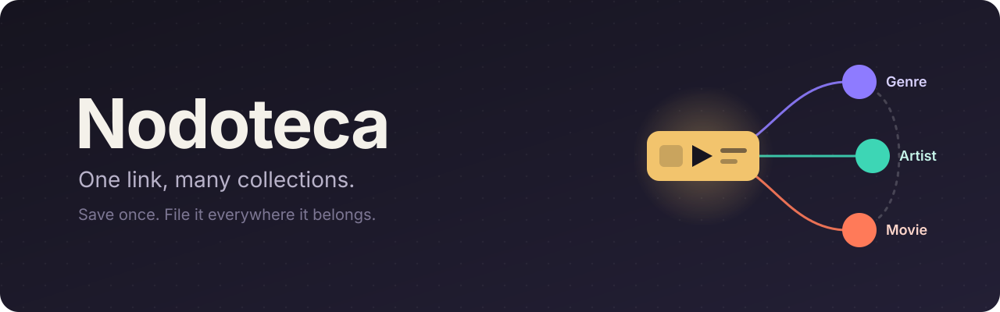
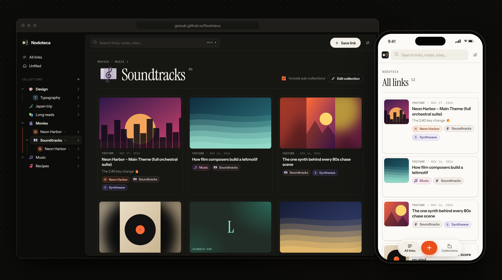

<p align="center">
  
</p>

<p align="center">
  <b>Una libreria web personale in cui un link può stare in tante raccolte.</b><br>
  Salvi un link una volta e lo metti in tutti gli argomenti a cui appartiene.<br>
  Duplicati ammessi. Le raccolte possono avere più di un genitore. Sincronizzazione su tutti i tuoi dispositivi.
</p>

<p align="center">
  
  
  
  
  
</p>

<p align="center">
  <a href="README.md">🇬🇧 English</a> · 🇮🇹 Italiano
</p>

<p align="center">
  
</p>

---

## 💡 Perché

Quasi tutti i gestori di segnalibri ti obbligano a scegliere **una** cartella
per ogni link. Ma un link raramente appartiene a un solo argomento.

Prendi un video YouTube in cui una canzone del **genere X**, dell'**artista Y**,
è usata in una scena del **film Z**. Lo vorresti in tutti e tre i posti. Nella
maggior parte dei gestori di segnalibri non si può, e i tag risolvono il
problema solo in parte.

Nodoteca tratta ogni link come un **nodo** che puoi collegare a quante raccolte
vuoi. Anche le raccolte sono nodi, quindi possono avere più di un genitore.

```
          ┌──▶ Genere X ────▶ Musica
  video ──┼──▶ Artista Y ───▶ Musica
          └──▶ Film Z ─────┬▶ Film
                            └▶ Colonne sonore
```

## ✨ Funzionalità

| | |
|---|---|
| 🕸️ **Più raccolte per link** | Metti un link in tutti gli argomenti che tocca. Resta un unico link: lo modifichi una volta e la modifica si vede ovunque. |
| 🧬 **Raccolte con più genitori** | "Film Z" può stare sia sotto *Film* sia sotto *Colonne sonore*. I cicli vengono bloccati in automatico. |
| ♻️ **Duplicati ammessi** | Se vuoi, puoi salvare di nuovo lo stesso URL. Nodoteca ti avvisa soltanto: *"già salvato in A, B"*. |
| 📎 **Conservi una copia** | Allega il PDF, l'immagine o il video a cui punta un link: resta tuo anche se la pagina cambia o sparisce. Puoi anche salvare un file da solo, con titolo, note e raccolte, come un link. |
| 🔄 **Sincronizzazione ovunque** | Un account per tutti i dispositivi. Le modifiche compaiono in tempo reale. |
| 🔎 **Ricerca per frammenti** | Basta un pezzo di parola: "anthr" trova "Anthropic". Cerca in titoli, note, siti, URL e nomi dei file. |
| 📲 **Salvi da ovunque** | Installala come app, condividi i link da qualsiasi app Android, o salva la scheda aperta con l'estensione Chrome. |
| 🔒 **Privato di default** | Row Level Security su Postgres: i tuoi dati li vedi solo tu. I file stanno in uno spazio privato e si aprono con link che scadono. |
| 🌍 **Multilingua** | Inglese e italiano per cominciare; per aggiungere una lingua basta un file. |
| 🌗 **Chiaro e scuro** | Segue il sistema, oppure scegli tu. |

<sub>Nodoteca è in sviluppo attivo e già in uso ogni giorno: l'app web, la PWA installabile e l'estensione per Chrome funzionano. Il prossimo passo è l'archiviazione intelligente. Vedi la [roadmap](#roadmap).</sub>

## 🧱 Tecnologie

| Parte | Tecnologia |
|---|---|
| Backend | [Supabase](https://supabase.com): Postgres, Auth, Realtime, Row Level Security |
| App web | React + Vite, PWA installabile (con il menu "Condividi" di Android) |
| Estensione | Chrome Manifest V3 |
| Codice condiviso | Pacchetto TypeScript `@nodoteca/core` |
| Repository | Un solo monorepo con npm workspaces |

## 📁 Struttura

```
Nodoteca/
├─ apps/
│  ├─ web/          # PWA per desktop e mobile
│  └─ extension/    # estensione Chrome
├─ packages/
│  └─ core/         # tipi e funzioni condivise
├─ supabase/
│  ├─ config.toml
│  └─ migrations/   # schema SQL versionato
└─ docs/            # architettura e risorse grafiche
```

Dettagli sul modello dati e sulle scelte di progetto in [docs/architecture.md](docs/architecture.md) (in inglese).
Per importare i tuoi link in un formato semplice (scritto a mano, da uno script o da un LLM) vedi [docs/import-format.md](docs/import-format.md).

## 🚀 Per iniziare

**Ti servono:** Node.js 22+ e un account [Supabase](https://supabase.com) gratuito.

```bash
git clone https://github.com/giozuki/Nodoteca.git
cd Nodoteca
npm install

# Collega il tuo progetto Supabase e applica lo schema
npx supabase login
npx supabase link --project-ref <id-del-progetto>
npm run db:push
npm run functions:deploy   # anteprime dei link

# Configurazione del client
cp .env.example .env   # poi inserisci URL e publishable key

npm run dev            # http://localhost:3000
npm run build:extension  # poi carica apps/extension/dist in chrome://extensions
npm test               # test del core e del database
```

> La **publishable key** è pensata per essere pubblica: a proteggere i dati è la Row
> Level Security. Non pubblicare mai la chiave segreta (`sb_secret_…` / `service_role`).

<a id="roadmap"></a>

## 🗺️ Roadmap

- [x] **Fase 1 · Fondamenta:** monorepo, modello dati, Row Level Security, RPC
- [x] **Fase 2 · App web (MVP):** accesso, salvataggio, più raccolte per link, navigazione, ricerca, anteprime
- [x] **Fase 3 · Cattura veloce:** estensione Chrome, PWA installabile, menu "Condividi" di Android
- [x] **Fase 4 · Importazione:** da Raindrop.io (CSV / HTML) e dai segnalibri del browser
- [x] **Fase 5 · Rifinitura:** export completo e backup, modalità offline (sola lettura)
- [x] **Fase 6 · Formato di importazione nativo:** un formato JSON semplice e documentato (raccolte per nome, più genitori, niente id) che tu o un LLM potete scrivere partendo da qualsiasi export, ad esempio per riorganizzare un export di Raindrop prima di importarlo
- [x] **Fase 7 · File:** allegati a un link (PDF, immagini, video…) o file salvati da soli; spazio privato con limiti per utente
- [ ] **Fase 8 · Classificazione intelligente:** raccolte suggerite in base a canzone, artista e film

<sub>Non pianificato, solo annotato: cosa servirebbe [se un giorno Nodoteca aprisse al pubblico](docs/going-public.md) (in inglese).</sub>

## 📄 Licenza

[MIT](LICENSE)
