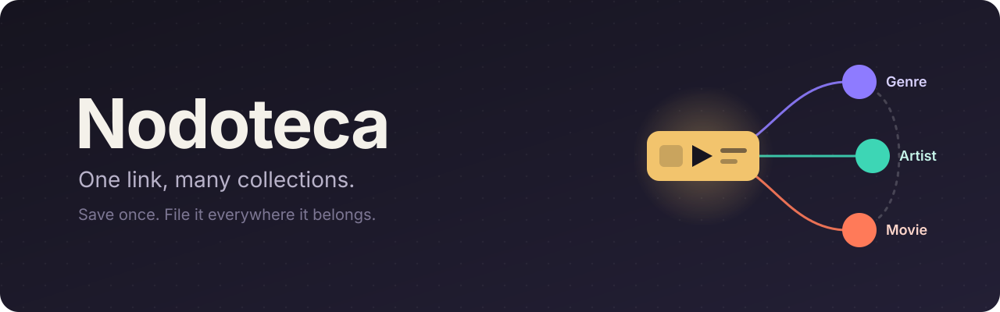

<p align="center">
  
</p>

<p align="center">
  <b>A link library where one link can live in many collections.</b><br>
  Save a link once and file it under every topic it belongs to.<br>
  Duplicates are allowed. Collections can have more than one parent. Syncs across your devices.
</p>

<p align="center">
  
  
  
  
  
</p>

<p align="center">
  🇬🇧 English · <a href="README.it.md">🇮🇹 Italiano</a>
</p>

---

## 💡 Why

Most bookmark managers make you pick **one** folder per link. Real links rarely
fit in one box.

Take a YouTube video where a song of **genre X**, by **artist Y**, is used in
a scene of **movie Z**. You want it in all three places. In most bookmark
managers you can't, and tags only partly make up for it.

Nodoteca treats a link as a **node** that you can connect to as many
collections as you like. Collections are nodes too, so they can have more than
one parent.

```
          ┌──▶ Genre X ────▶ Music
  video ──┼──▶ Artist Y ───▶ Music
          └──▶ Movie Z ───┬▶ Movies
                           └▶ Soundtracks
```

## ✨ Features

| | |
|---|---|
| 🕸️ **Many collections per link** | File a link under every topic it touches. It's still one link: edit it once and the change shows up everywhere. |
| 🧬 **Collections with many parents** | "Movie Z" can live under both *Movies* and *Soundtracks*. Cycles are blocked automatically. |
| ♻️ **Duplicates allowed** | Save the same URL again if you want to. Nodoteca only warns you: *"already saved in A, B"*. |
| 🔄 **Sync everywhere** | One account, every device. Changes show up in real time. |
| 🔎 **Search as you think** | Type any part of a word: "anthr" finds "Anthropic". Searches titles, notes, sites and URLs. |
| 📲 **Save from anywhere** | Install it as an app, share links to it from any Android app, or save the current tab with the Chrome extension. |
| 🔒 **Private by default** | Row Level Security in Postgres: you are the only one who can see your data. |
| 🌍 **Multilingual** | English and Italian to start, and adding a language means adding one file. |
| 🌗 **Light and dark** | Follows your system, or pick one. |

<sub>Nodoteca is in early development. The data model and backend are in place, and the apps are next. See the [roadmap](#roadmap).</sub>

## 🧱 Tech stack

| Part | Tech |
|---|---|
| Backend | [Supabase](https://supabase.com): Postgres, Auth, Realtime, Row Level Security |
| Web app | React + Vite, installable PWA (with the Android share sheet) |
| Extension | Chrome Manifest V3 |
| Shared code | TypeScript package `@nodoteca/core` |
| Repo | Single monorepo with npm workspaces |

## 📁 Repository layout

```
Nodoteca/
├─ apps/
│  ├─ web/          # PWA for desktop and mobile
│  └─ extension/    # Chrome extension
├─ packages/
│  └─ core/         # shared types and helpers
├─ supabase/
│  ├─ config.toml
│  └─ migrations/   # versioned SQL schema
└─ docs/            # architecture and assets
```

More on the data model and design choices in [docs/architecture.md](docs/architecture.md).

## 🚀 Getting started

**You need:** Node.js 22+ and a free [Supabase](https://supabase.com) account.

```bash
git clone https://github.com/giozuki/Nodoteca.git
cd Nodoteca
npm install

# Link your Supabase project and apply the schema
npx supabase login
npx supabase link --project-ref <your-project-ref>
npm run db:push
npm run functions:deploy   # link previews

# Client config
cp .env.example .env   # then fill in URL and publishable key

npm run dev            # http://localhost:3000
npm run build:extension  # then load apps/extension/dist in chrome://extensions
npm test               # core + database tests
```

> The **publishable key** is meant to be public, and Row Level Security is what
> protects your data. Never commit the secret (`sb_secret_…` / `service_role`) key.

<a id="roadmap"></a>

## 🗺️ Roadmap

- [x] **Phase 1 · Foundations:** monorepo, data model, Row Level Security, RPCs
- [x] **Phase 2 · Web app (MVP):** sign-in, save, file in many collections, browse, search, link previews
- [x] **Phase 3 · Quick capture:** Chrome extension, installable PWA, Android share sheet
- [ ] **Phase 4 · Import:** from Raindrop.io (CSV / HTML) and browser bookmarks
- [ ] **Phase 5 · Polish:** offline mode, full export, shareable collections
- [ ] **Phase 6 · Smart filing:** collection suggestions from song, artist and movie metadata

## 📄 License

[MIT](LICENSE)
