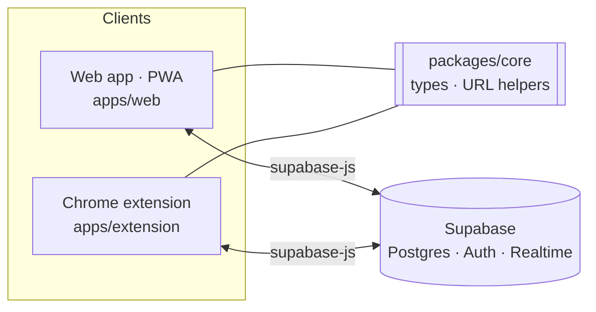
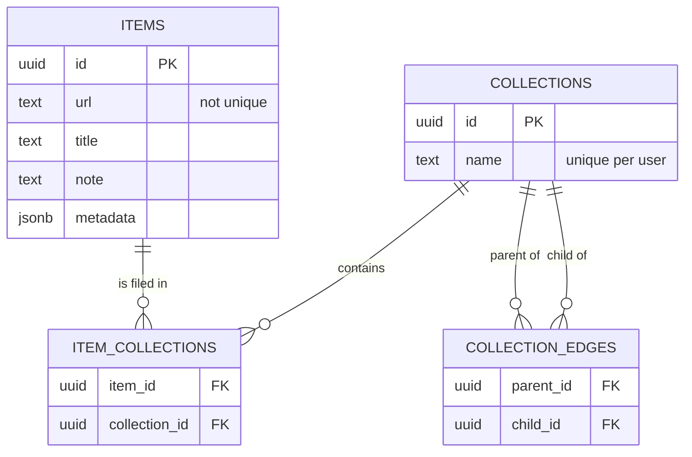

# Architecture

## Overview

Both clients talk directly to Supabase with the public **publishable key**. Security
lives in the database: every table has Row Level Security, so a signed-in user
can only read and write rows where `owner_id = auth.uid()`.

Sync between devices comes from the database itself: every device reads and
writes the same rows, and Supabase Realtime pushes changes to open clients.

## Data model

### Design choices

| Choice | Why |
|---|---|
| **Items ↔ collections is many-to-many** | The whole point of Nodoteca: a link belongs to every topic it touches. |
| **URLs are not unique** | Saving the same link twice is allowed. `find_saved(url)` lets the UI warn ("already in A, B") instead of refusing. |
| **Collections form a graph (DAG), not a tree** | A collection can have several parents, so "Movie Z" can sit under both *Movies* and *Soundtracks* without being copied. A trigger rejects cycles. |
| **Collection names are unique per user** | A name *is* the node. "Rock" reached from two parents is the same "Rock". |
| **`owner_id` on join tables** | Keeps RLS policies simple and fast; `with check` also verifies both ends belong to the user. |
| **Full-text search in Postgres** | A generated `tsvector` (title > note > description > site/URL) plus a trigram index on titles. No extra search service. |

### RPCs

| Function | Purpose |
|---|---|
| `save_item(p_url, p_collection_ids[], ...)` | Inserts an item and files it in several collections in one round trip. |
| `find_saved(p_url)` | Returns earlier saves of the same URL and the collections they are in. |
| `set_item_collections(p_item_id, p_collection_ids[])` | Replaces the whole set of collections of an item, atomically. |
| `set_collection_parents(p_collection_id, p_parent_ids[])` | Replaces the parents of a collection; the cycle trigger still applies. |
| `collection_counts()` | Number of items directly inside each collection, for the sidebar. |

URLs are normalized on the client (`normalizeUrl` in `packages/core`) before
`save_item` and `find_saved`, so `youtu.be/x?si=…` and `youtube.com/watch?v=x` match.

## Link previews

Browsers cannot read other sites' HTML, so the `link-preview` Edge Function
(`supabase/functions/link-preview`) does it: YouTube through oEmbed, any other
page through its OpenGraph / `<title>` tags. It only answers signed-in users,
blocks private and loopback addresses (also after redirects), reads at most
512 KB per page and never makes a save fail: no preview just means no thumbnail.

## Realtime sync

All four tables are in the `supabase_realtime` publication. The web app listens
for any change and refetches, so an edit on the phone shows up on the laptop
within a second. RLS applies to realtime too.

## Hosting

The Supabase free tier is enough for development and early users (500 MB
database, 50k monthly active users). Free projects pause after a week without
traffic; upgrading to Pro removes that when Nodoteca opens to the public.
Nothing in the code depends on the plan.
