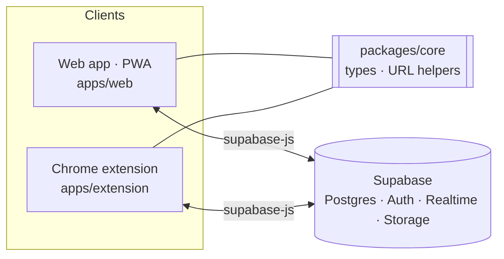
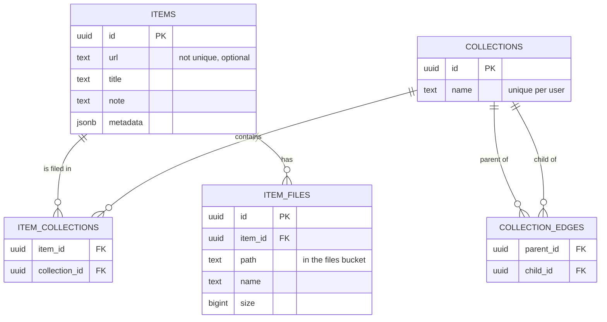

# Architecture

## Overview

Both clients talk directly to Supabase with the public **publishable key**. Security
lives in the database: every table has Row Level Security, so a signed-in user
can only read and write rows where `owner_id = auth.uid()`.

Sync between devices comes from the database itself: every device reads and
writes the same rows, and Supabase Realtime pushes changes to open clients.

## Data model

### Design choices

| Choice | Why |
|---|---|
| **Items ↔ collections is many-to-many** | The whole point of Nodoteca: a link belongs to every topic it touches. |
| **URLs are not unique** | Saving the same link twice is allowed. `find_saved(url)` lets the UI warn ("already in A, B") instead of refusing. |
| **Collections form a graph (DAG), not a tree** | A collection can have several parents, so "Movie Z" can sit under both *Movies* and *Soundtracks* without being copied. A trigger rejects cycles. |
| **Collection names are unique per user** | A name *is* the node. "Rock" reached from two parents is the same "Rock". |
| **`owner_id` on join tables** | Keeps RLS policies simple and fast; `with check` also verifies both ends belong to the user. |
| **A link, files, or both** | An item usually is a link. Files attached to it keep a copy of what it points to, in case the page changes or disappears; an item can also be made only of files. A deferred constraint trigger makes sure every item has a URL or at least one file. |
| **Full-text search in Postgres** | A generated `tsvector` (title > note > description > site/URL) plus a trigram index on titles. No extra search service. |

### RPCs

| Function | Purpose |
|---|---|
| `save_item(p_url, p_collection_ids[], ...)` | Inserts an item and files it in several collections in one round trip. |
| `find_saved(p_url)` | Returns earlier saves of the same URL and the collections they are in. |
| `set_item_collections(p_item_id, p_collection_ids[])` | Replaces the whole set of collections of an item, atomically. |
| `set_collection_parents(p_collection_id, p_parent_ids[])` | Replaces the parents of a collection; the cycle trigger still applies. |
| `collection_counts()` | Number of items directly inside each collection, for the sidebar. |
| `save_item(..., p_files)` | Also records files already uploaded to Storage, in the same transaction. |
| `add_item_files(p_item_id, p_files)` / `remove_item_file(p_file_id)` | Attach or forget files; `remove_item_file` returns the Storage paths to delete. |
| `set_item_file_order(p_item_id, p_file_ids[])` | Reorders an item's files (the first opens from the card when there is no link). |
| `find_saved_file(p_sha256)` | Earlier saves of the same content, for the "already saved in A, B" hint. |
| `storage_usage()` | Space used by the user's files and the limits that apply to them. |

URLs are normalized on the client (`normalizeUrl` in `packages/core`) before
`save_item` and `find_saved`, so `youtu.be/x?si=…` and `youtube.com/watch?v=x` match.

## Files

Files live in a **private** Storage bucket, `files`, under
`<user id>/<random folder>/<safe file name>`; the original name is kept in
`item_files.name`. Storage policies let each user touch only their own folder.

1. The web app hashes the file (SHA-256, for the duplicate hint), uploads it
   with the user's JWT, and for images also uploads a small WebP preview in the
   same folder (`thumb_path`).
2. `save_item` / `add_item_files` record it. A trigger checks that the object
   really exists, takes its **size from Storage** (not from the client), and
   enforces the limits. If recording fails, the client deletes the upload.
3. Files open through **signed URLs** that expire: 1 minute for downloads,
   1 hour for images and PDFs, 4 hours for videos. Only images, PDFs and videos
   open in a tab; everything else (SVG included, since it can carry scripts) is
   downloaded.
4. Deleting an item or a file removes the row first, then the objects: a
   failure leaves an unreachable object behind, never a row without its file.

**Limits** are data, not code: defaults of 50 MB per file and 800 MB in all
(`storage_limits_for()`), overridden per user by a row in `storage_limits`
that only the project owner can write. The bucket's own `file_size_limit`
(50 MB, the most Supabase's free plan accepts per upload) is the ceiling
above every per-user limit. At most 20 files per item.

The JSON export describes files (name, size, type, hash) but does not contain
them, and the offline copy shows them without being able to open them.

## Link previews

Browsers cannot read other sites' HTML, so the `link-preview` Edge Function
(`supabase/functions/link-preview`) does it: YouTube through oEmbed, any other
page through its OpenGraph / `<title>` tags. It only answers signed-in users,
blocks private and loopback addresses (also after redirects), reads at most
512 KB per page and never makes a save fail: no preview just means no thumbnail.

## Realtime sync

All four tables are in the `supabase_realtime` publication. The web app listens
for any change and refetches, so an edit on the phone shows up on the laptop
within a second. RLS applies to realtime too.

## Hosting

The Supabase free tier is enough for development and early users (500 MB
database, 50k monthly active users). Free projects pause after a week without
traffic; upgrading to Pro removes that when Nodoteca opens to the public.
Nothing in the code depends on the plan.
